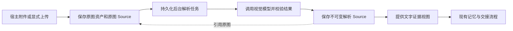

# 图片 Source 实验功能建设指南

本实验为 PowerContext 增加默认关闭的图片证据摄取能力。图片进入指定 Scope 后，先保存原图，再由后台视觉模型解析，保存带有原图引用的解析 Source，并通过文字证据视图参与现有记忆与交接流程。

实验在独立 worktree 和分支推进，对应上游 [#1932](https://github.com/oceanbase/powercontext/issues/1932)。用户已授权提交草稿 PR，供维护者讨论实现范围；完整真实验收和最终复审尚未完成，不视为可以合并或发布。当前状态以 [整合审查报告](integration-review.md) 为准。功能建设以本指南为执行依据；每次 AI Coding 都必须更新 [实施过程记录](implementation-log.md)，保留实际改动、验证证据、限制和下一步。

阶段零的资料与宿主探测见 [可行性结论](feasibility.md) 和 [Codex 附件证据](codex-capture-evidence.md)。数据、操作和预算以 [固定契约](contracts.md) 为准，必要接入点见 [接入分析](contract-integration-analysis.md)。显式上传、后台解析、重试与文字记忆链路见 [解析与记忆说明](phase34-usage.md)；可选配置引导见 [捕获与查看说明](phase56-usage.md)。Codex Desktop 和 CLI 的共享采集器、真实 MiniCPM-V 35B、普通模型 Memory 与后端检索已联调；桌面界面拖图、粘贴组合及全新桌面会话自动召回仍需按 [桌面验收指南](desktop-testing.md) 验证。交互 CLI TUI 与其他未知版本未开放。

## 实验目标与完成条件

目标是让工作图片中的信息在后续会话中可检索、可解释，并能回到原图核查。Source 接收、视觉解析、记忆生成和跨会话召回是不同结果，必须分别验证和报告。

实验完成需满足以下条件：

- 显式 CLI 或 SDK 上传一张 PNG 或 JPEG 后，原图及来源能够持久化并通过受支持接口回读。
- 后台模型生成经校验的解析结果，结果以新的不可变 Source 保存，并提供已有的文字证据能力。
- 解析结果能够通过既有 Memory 流程生成有来源的记录，并在新的会话中被检索和追溯。
- 图片解析失败、断网或服务重启不会丢失已接受的原图，也不会堵住普通文字处理。
- 默认关闭时没有自动图片采集、图片持久化、视觉模型调用或历史附件扫描。
- 至少一个实际视觉模型完成真实验收。Codex 自动捕获单独按真实宿主版本和输入方式验收；无法取得附件时，显式上传路线仍可使用，但不得宣称 Codex 自动捕获完成。

## 工作区与现有契约

| 项目 | 固定约束 |
| --- | --- |
| Worktree | D:/code/git-project/powermem/powermem-image-source-experiment |
| 本地分支 | codex/experiment-image-source |
| 起始提交 | 6b2f6e8a4c1aac59fca75662aca26d78748bfa29 |
| 当前主干基线 | 75481152ddd97f2de34607ede8297069334eb20e（Atomic Memory、召回通道权重与并行测试） |
| 实验文档 | docs/experiments/image-source/ |
| 运行环境 | 首版只支持独立文件 SQLite 实验部署；WAL／DELETE journal、FULL 及以上 synchronous |
| 私有运行数据 | worktree 内已被忽略的 .powercontext/image-source-experiment/ |
| 上游同步 | 已授权草稿 PR；合并、发布和 managed-local 扩展另行推进 |

所有实现、测试和环境命令在实验 worktree 中执行。使用独立数据库、资产目录、环境文件和服务端口，不使用主 checkout 的环境文件、已有数据库或已运行服务。Git worktree 共享仓库对象和部分 Git 配置，禁止通过修改共享配置实现实验隔离。

当前主干有以下可复用能力和实际限制：

- Source Definition、远程 manifest 和 SourceObservation 可以声明并保存自定义 Source；已有 powercontext.text-evidence 文字证据能力。
- 当前 SourceRef 仍是 source_type 与 source_id 的组合，由操作所属 Scope 提供分区；同一身份写入不同内容会发生冲突。
- RFC 1400 中完整的 SourceKey、observation_id 和 current head 模型不是本实验可以直接假定已实现的基础设施。本实验不全局改造这些公共身份类型。
- 当前通用结构化生成器把输入序列化为文字 JSON。视觉适配必须构造真正的多模态输入，不能仅把图片路径或 Base64 放进文字 JSON。
- 主干 Codex 插件只采集文字 prompt；实验增加默认关闭的附件捕获。UserPromptSubmit 与 MCP 均不保证提供图片字节；CLI 使用 Hook 注册当前轮次，Desktop 使用只读索引发现已授权项目的会话，两端通过有界增量读取、暂存与同一上传队列接入。
- 远程 SourceObservation 的现有上限是 4 MiB。原图资产单独存储，不能把大段 Base64 作为 Source 正文进入文字模型。

新增 HTTP 契约以 openapi/powercontext.yaml 为唯一来源；修改后运行 make api-generate 与 make contract-test，不能手改 src/powercontext/http/_generated/。阶段一只添加 component 和同文件内的未激活操作声明；对应实现、Access 和 Client 验收完成后再移入标准 paths，避免公开尚不可调用的接口。

## 范围边界

| 首版包含 | 首版不包含 |
| --- | --- |
| PNG 和 JPEG 的显式上传、持久化、回读 | 视频、音频、PDF、动图、SVG 和通用文档解析 |
| 一张图片对应一个后台解析任务 | 跨图片推理、多图自动比较、视频帧处理 |
| 原图 Source 与带来源的解析 Source | 图片向量检索、以图搜图和多模态 embedding |
| OCR 文字、视觉描述、必要关系与不确定项 | 自动执行截图中的指令、自动诊断并确认根因 |
| 独立 Vision 配置和 OpenAI Chat 兼容适配 | 默认安装 Torch、CUDA、下载或托管模型权重 |
| SQLite 上的可恢复任务与有界处理 | OceanBase、seekdb 的图片能力承诺或分布式调度 |
| 经验证的 Codex 适配和通用 CLI 或 SDK | 一次性覆盖所有 Agent、全盘扫描缓存、自动导入聊天历史 |
| 现有证据入口、最小原图查看和配置引导 | 新建完整素材管理产品、独立桌面应用或大规模 UI 重构 |

同一消息有多张图片时，可以按附件顺序拆成独立任务；这不代表支持多图联合理解。PNG 和 JPEG 必须验证实际文件格式、字节大小和解码后的像素限制，其他格式在耐久接收前明确拒绝。

扩展宿主、格式、后端或检索方式时，先将用户明确提出的新范围写入指南，再调整阶段任务。实现过程中发现缺口时记录问题，不通过顺便增加新能力绕过现有边界。

### Codex 多端采集扩展

用户已明确授权真实 Desktop Hook 时序探测，以及 Desktop 采集器和 CLI 共用接入。扩展仅针对经过实际验证的 Codex 版本和输入表示：提交后按当前会话、轮次、消息及附件位置关联；有界增量读取；及时暂存；持久上传队列；恢复与幂等；持久客户端开关；既有 Source、Vision、Memory 和 Dashboard 复用。尚未发送或撤回的图片不采集，不扫描其他会话或补导历史。

桌面图片块如果只能证明是宿主提交的图片，必须记录其表示类型，不能声称是磁盘原始文件。历史原图 Source 和旧 CLI 回执需保持可读与幂等。真实桌面上传、真正 Hook 回调、直接调用脚本、受控 app-server 和实际 Vision 分别记录；不得用其中一种代替另一种。配置与探测 Hook 安装已授权，Codex 自身的 Hook 审阅与信任要求仍按宿主执行。

扩展步骤为真实时序与附件探测、共用暂存和上传队列、两端适配与配置、完整 Source／Memory／Dashboard 验收及 Open Code Review 修复。大样本质量评估仍属于阶段七，不因多端实现完成自动标记完成。

本机已验证自动采集、真实识图、真实 DeepSeek 后台 Memory 生成，以及 BGE-M3 参与的向量／混合检索；Memory 原始材料可回到历史图片。全新桌面聊天的实际命中与自动注入仍须独立验收，后端检索和受控 CLI 结果不能替代该验收。实验使用独立来源插件和隔离服务；全局插件切换、模型配置、原配置保留与恢复办法见桌面验收指南。

## 实现链路与职责

### 正式使用流程整合

用户已授权将图片能力融入常规 PowerContext 使用流程，并在当前 worktree 实现、测试及审查。本轮允许：对齐当前主分支；标准 Server 包包含轻量图片解码依赖；普通向导提供默认关闭的图片选项；显式选择复用兼容的多模态 Generation 连接或独立 Vision 连接；正式 Codex setup 持久管理采集授权和客户端采集器生命周期；沿用会话 Scope；Dashboard 增加按 Scope 分页的图片材料入口及诊断。保留现有原图、解析 Source 身份和历史读取，继续使用原有 Memory／Topic Memory 策略。用户无需额外维护实验 env 或手工运行采集脚本。

客户端采集在 Codex 本机运行，服务端负责持久接收与视觉解析；远程 Server 不扫描宿主文件。开关关闭不采集历史、不调用模型。客户端托管仅在用户显式开启该功能的正常安装流程中建立，保留首次 Hook 审阅要求。默认不依赖未开放的私有模型，不扩展到其他文件格式、未验证宿主、图片向量或其他数据库后端。上游提交和发布仍须用户另行请求。

验收以标准安装／配置／setup 入口为准，覆盖客户端冷启动与恢复、CLI／实际桌面内核、独立与复用模型配置、Scope 切换、图片列表、后台制品处理、关闭及历史证据。完整测试、Open Code Review 问题与修复记录、复杂图片及核对案例在完成前写入实施记录和测试说明。

| 模块 | 职责 |
| --- | --- |
| 宿主适配器与 Client | 取得实际附件、保留来源、及时复制临时图片、按已绑定 Scope 提交字节；不定义记忆规则 |
| 图片摄取模块 | 校验格式与预算，保存资产、原图 Source 和任务，提供耐久接收结果 |
| 视觉解析模块 | 构造多模态请求，控制超时和重试，校验输出，记录模型与解析配置 |
| 图片任务处理器 | 恢复待处理任务，管理并发与失败状态，原子保存解析 Source 和任务完成结果 |
| Source Definition | 声明类型、身份、来源和固定的文字投影；投影不调用模型 |
| 既有 Artifact 服务 | 从可消费的文字证据继续提取和检索，保留具体来源引用 |
| HTTP、MCP、CLI、Dashboard | 翻译调用与结果，执行权限检查，展示真实状态和原图 |

定义图片类型的代码位于它所属的图片摄取或解析模块。沿用现有 Source Definition 和声明式 observation 边界，不把宿主依赖或可执行插件包加载进 Server。识图是 Source 加工任务，不为复用 Artifact 调度而虚构一个 Artifact family，也不放进 Memory flush 中隐式执行。

## 数据与状态规则

### 原图与解析结果

采用两个有明确 schema 的原生 Source 类型：experimental.image.original 保存资产引用与来源；experimental.image.analysis 保存机器解读和原图引用，Definition 版本均为 1。名称和版本保持稳定，不用 ContentSource.metadata 模拟这两个类型。两个无模型调用的 Definition 在阶段二接入共同内置 registry，功能关闭时仍支持历史读取。

原图记录至少包含资产标识、SHA-256、MIME、字节数、尺寸，以及已知的宿主、会话、轮次和附件位置。Scope 来自已经解析的绑定，不从文件路径或模型输出推导。显式上传没有宿主轮次时，使用调用方提供的稳定摄取键，不能虚构宿主字段。

解析记录至少包含原图所属 Scope 和精确 SourceRef、OCR 文字、视觉描述、不确定项，以及实际模型标识、解析 schema、提示模板、预处理版本和所使用的上下文摘要标识。实体与关系只保存图片中可见且任务需要的内容。

原图是权威材料，解析结果是机器生成的解读。图中显示连接失败，可以记录可见错误；不能仅凭错误界面认定根因。草图不能自动转成已确认决策。模型自报置信度不当作已校准概率，也不作为自动切换模型的唯一依据。

文字证据视图从已经保存的解析结果生成，对同一精确记录返回相同内容；Source read、projection、Memory 和 Handoff 不重新调用视觉模型。原图引用必须能通过正式读取路径追溯，不能仅保存一个不再可读的宿主临时路径。

### 身份与去重

- 资产在同一 Scope 内按原始字节摘要去重；不同上传场景的来源记录仍分别保留。
- 原图 Source 身份根据稳定摄取键及附件位置确定，并验证重放的字节与来源一致。同文不同图、图片-only 和附件顺序均需正确表达。
- 同一身份、相同 canonical payload 的重放返回原结果；不同 payload 返回冲突，不以随机换 ID 掩盖冲突。
- 解析任务有稳定幂等键。键至少区分原图引用、模型部署或版本、schema、提示模板、预处理和实际使用的上下文；不能只按图片摘要复用有不同语义的结果。
- 首版采用与当前 SourceRef 兼容的独立不可变解析记录。手动重新解析创建新的任务或解析代次，保留旧 Source 和已经引用它的 Artifact；不增加全局 observation_id。
- 首版只去重资产与相同请求，不增加模型结果缓存。原图和解析属于同一证据链，同 Scope 同字节的重复上传、重试或重新解析不能作为独立事实重复加权。

### 耐久接收与失败恢复

耐久接收结果只有在资产、原图 Source 和任务均已保存后返回。文件与数据库的写入需要明确处理不共享事务的情况：先耐久保存完整资产，再提交引用它的记录；中途失败产生的孤立文件可被有界清理，不能接受一个没有可读资产的 captured Source。

任务使用 pending、running、retry_wait、succeeded、failed、cancelled 等明确状态。succeeded 只表示解析 Source 已经耐久保存；是否生成 Memory 由既有记忆处理结果决定。解析 Source 写入、任务完成确认和必要下游通知使用同一数据库提交边界。

进程重启必须恢复 pending 和中断的 running 任务。持久化任务配置快照或配置摘要，配置变化后不能把旧任务静默改用当前模型；快照不保存密钥。以稳定结果和幂等键防止重复写入，不承诺模型请求 exactly-once，响应丢失时可能产生重复调用费用。

临时错误按有限次数和退避重试；格式错误、无效结构化结果及预算超限得到明确失败状态。单图永久失败不堵住后续图片或普通文字；失败原图保留供检查，支持显式重试。关闭功能后不再采集或开始新任务，进行中的任务完成当前耐久提交或恢复为可重试状态，不删除已有证据。

自动退避重试保留同一 task_id 并累计次数；手动重试创建新任务并固定旧失败任务配置；重新解析创建新任务并在接收时固定当前配置。后两者都保留旧任务与 Source。readability 为 unreadable 的合格结果可以保存审计 Source，但不进入文字生成。

原图在共同生成准入规则中明确排除，文字窗口跳过并正常推进；不能仅依赖缺少投影。解析完成后追加新的解析 Source，触发现有处理意图和 Topic Memory pending 水位，确保较早游标已经前进也不会漏掉迟到结果。显式把不支持的原图提交给文字生成时明确拒绝，不回退成 Base64 或任意 JSON 输入；已有文字 Source 的行为保持兼容。

### 存储与权限

原图、缩略图、任务和解析记录服从同一 Scope 边界。资产读取、重试、重新解析、删除及证据回溯都做现有身份和 Scope 权限检查，不能通过知道摘要或资产 ID 跨 Scope 读取。

首版客户端只提交图片字节；不提供让 Server 任意读取客户端路径或抓取 URL 的入口。临时图片先复制到有界的受管理位置，原文件删除后仍能回读已接受图片。资产路径由服务生成，不使用上传文件名拼接实际存储路径。

备份必须包含 SQLite 数据与所引用的资产。被 Source 或 Artifact 引用的资产受保留规则保护；自动清理只处理可证明未被引用的孤立资产。首版不提供单条证据删除；完全弃用隔离部署时先停止服务、备份并核对实验路径，再清理整套数据。旧证据不能被重定向到另一张图片。

## 配置与模型策略

公开默认关闭且模型未配置。启用时显式选择独立 Vision，或复用支持图片输入的 OpenAI Chat generation 连接；两种选择使用同一后台解析与快照校验，不根据模型名猜测能力，不自动切换服务。普通向导、同一 .env 和标准 Codex setup 完成配置与授权。

| 配置内容 | 首版规则 |
| --- | --- |
| 功能总开关 | 默认关闭；独立于现有完整记忆能力选项 |
| 模型连接 | 显式协议、endpoint、模型 ID 和凭据引用；优先 OpenAI Chat 兼容接口 |
| 调用预算 | 超时、最大尝试次数、输出上限和任务并发均有正数限制 |
| 图片预算 | 单图字节、解码像素、每次摄取数量和持久待处理数量有界 |
| 自动采集 | 按宿主和 Scope 控制，仅开放实际验收通过的输入方式 |
| 保存与发送 | 明确资产目录、保留规则和实际推理 endpoint |

关闭功能时无需 Vision 凭据，不加载重型推理依赖、不探测模型、不扫描历史附件。启用但缺少必要配置时返回明确配置错误。运行中模型不可用时，图片能力报告失败或等待状态，普通文字能力继续工作。

MiniCPM-V-4.7-1B 和 MiniCPM-V-4.7-35B-A3B 是本实验的候选模型，允许用户在私有配置中指定。模型名不是 API 兼容性、账号资格、权重可获取性或本机可运行性的保证；以实际 endpoint 返回和测试结果记录能力。

先使用文字提示加一张图片的多模态输入。使用专用 Chat 适配器发送真正图片，复用现有用量类型和统计入口。每次适配器调用恰好一个网络尝试，重试由持久任务控制。首版选择 prompted_json，并用固定 schema 本地严格校验；不能假定所有 OpenAI-compatible 服务支持 Responses、Files、detail、工具调用或原生 JSON Schema。实际服务不满足该最小方式时明确报告未适配，失败不能以原始模型文本冒充有效解析。

本地推理和远端 API 明确区分。核心实验调用已部署的服务，不管理模型下载与 GPU。仅在真实样本证明效率和质量符合目标后选默认模型；不因参数规模预先宣称质量、延迟或显存需求。

## 分阶段建设任务

阶段零至六已完成当前约定的验收，阶段七待推进。未支持的宿主组合仍保持未验证。阶段按依赖推进，每个阶段保留独立可检查结果。宿主拿不到附件时采用显式上传路线，不扩大到全盘搜索。缺少候选模型凭据时允许推进离线实现，但该模型的真实验收保持待验证；当前仅 35B 已验收。

### 阶段零 验证真实输入与模型接口

1. 建立隔离的 SQLite、资产目录、环境文件和端口，记录当前宿主与依赖版本。
2. 分别测试 Codex CLI、Desktop 的上传和粘贴；覆盖图片-only、文字加图、同文不同图和多附件。
3. 检查实际 hook 或受支持记录中的字节、可读路径、时间关系和附件身份，只保留脱敏样本。
4. 用自制文字与图形测试图验证候选模型实际看图能力，再验证中文、结构化输出、超时和错误响应。
5. 确定首个自动宿主适配范围、模型协议和候选模型能力；未验证组合保持未支持。

交付物：docs/experiments/image-source/feasibility.md，包含宿主能力矩阵、模型能力矩阵和可复现操作。私有响应、凭据与原始图片放入忽略的实验目录。

阶段验收：明确至少一种可以拿到真实字节的通用输入方式；模型接口已实际验证，或明确列为需要用户私有配置的待验证项。只有真实上传测试通过的宿主组合可以进入自动捕获开发。

### 阶段一 固定数据与操作契约

1. 定义原图与解析 Source 的 schema、稳定类型名、版本、来源关联、canonical payload 和冲突规则。
2. 定义图片摄取、资产读取、任务查询、失败重试和重新解析的最小操作；明确成功响应代表哪种耐久结果。
3. 定义文字投影、原图过滤、来源回溯和迟到解析结果的 journal 行为，检查 Memory 及其他相关 consumer。
4. 定义功能开关、预算默认值、实验数据格式版本，以及关闭、重启、配置变化和旧实验记录的兼容处理。
5. 将新增数据 schema 和未激活操作声明加入唯一 OpenAPI 文件并生成 DTO，单独检查操作引用与权限；阶段二和三实施对应行为时再激活标准 paths。避免修改已有 SourceRef 与非图片接口。

交付物：docs/experiments/image-source/contracts.md 与必要的契约代码。契约中的数值预算标明初始选择依据，不能伪称经过性能测量。

阶段验收：一次摄取到回读、一次解析到文字消费的身份和失败含义无歧义；生成契约检查通过；不支持的数据格式在写入前拒绝，不静默重写已保存记录。

### 阶段二 完成原图摄取与回读

1. 实现格式、字节和像素校验、Scope 内资产保存以及摘要验证。
2. 实现耐久原图 Source 与 pending 任务的接收，明确文件和数据库的失败恢复。
3. 提供 HTTP、Client 与最小 CLI 上传路径；本地 CLI 读取本地文件，Server 接收字节。
4. 实现受权限控制的资产回读、任务查询和备份范围说明；不要求模型在线才能读取已保存原图。
5. 验证原文件删除、服务重启、重复请求、同文不同图、越权请求和损坏文件。

交付物：可执行的显式上传与原图回读链路，以及 focused 行为测试。

阶段验收：耐久接收后原图可读且摘要相同；重复提交不重复添加同一来源记录；失败摄取不留下被接受但不可读的 Source；功能关闭时拒绝实验摄取。

### 阶段三 完成视觉解析与任务恢复

1. 添加独立 Vision 配置和专用 Chat 多模态适配；使用有界超时和严格本地校验，复用已有用量类型与统计入口。
2. 实现固定解析 schema、提示模板和预处理记录，区分可见内容、解释及不确定项。
3. 通过 SQLite owner 租约保证一个有效后台 worker，实现任务恢复、有限重试和待处理预算；不新增分布式工作流系统。
4. 原子保存解析 Source 与成功状态；落实幂等键、结果复用、手动重试和重新解析保留旧结果。
5. 统计解析次数、成功率、失败原因、延迟和 provider 实际报告的用量；未知 token 数不当作零。

交付物：可恢复的解析 worker、解析 Source、状态 API 和真实模型验证记录。

阶段验收：至少一个候选模型成功处理真实图片；模型断网或输出无效时保留原图且状态准确；中断恢复不产生重复有效解析记录；禁用后不开始新任务。

### 阶段四 接入文字证据与跨会话复用

1. 从持久化解析结果生成 powercontext.text-evidence，读取与投影不调用模型。
2. 放行提供有效文字投影的可读解析 Source；原图始终排除，不可读解析只保留审计。保证原图、不可读解析和失败任务不会堵住文字窗口。
3. 解析完成后以新的 Source sequence 通知既有处理链路，验证迟到结果没有漏消费。
4. 验证 Memory 提取、检索和来源回读；对实际涉及的 Topic Memory、Handoff 等入口补兼容检查。
5. 防止模型猜测成为已确认事实，保持 Scope 权限和精确旧引用；原图与解析不作为独立证据重复计权。

交付物：Source 到 Memory 再到新会话检索的 acceptance 场景，以及文字流程兼容检查。

阶段验收：新的会话可以通过文字查询找回图片相关信息，并回读所引用的解析版本和原图；重新解析不改变已有 Artifact 的证据；模型离线时已保存证据仍可用。

### 阶段五 接入经过验证的 Codex 输入

1. 为阶段零已证明可获得图片的 Codex 版本和输入方式增加可选适配。
2. 复用现有 Scope 绑定，处理图片-only、附件顺序、同文不同图和宿主重放。
3. Hook 只做有界获取与提交；临时文件及时复制，失败有明确诊断，不同步等待视觉推理。
4. transcript 适配限定格式和版本，按增量读取，不全量扫描会话或宿主缓存；不支持时提供显式上传方式。
5. 在真实 Codex CLI 或 Desktop 中执行上传、重启和新会话召回验收，分别记录通过的组合。

交付物：经过真实宿主验证的可选适配器和更新后的能力矩阵。

阶段验收：真实宿主上传确实触发接收，结果与输入图片一致，普通会话不受阻塞；未通过的版本或方式仍标为未支持。直接调用 hook 的测试只能证明本地处理，不能替代此验收。

### 阶段六 完成引导与最小证据查看

1. 为安装或配置向导增加可跳过的实验开关，已有记忆选项不隐式开启图片功能。
2. 启用后配置独立 Vision 角色，显示保存目录、推理 endpoint 和当前宿主支持范围。
3. 配置静态验证与真实识图探测分别呈现；显式测试使用无敏感信息的测试图。
4. 在现有证据页面提供原图查看、解析文字、不确定项、模型来源和真实处理状态。
5. 补充启用、关闭、重试、重新解析、备份和删除说明；不改公共站点导航或发布文档。

交付物：最小配置引导、证据查看入口和实验使用说明。

阶段验收：未启用用户无需 Vision 配置；用户能区分图片保存、解析成功与记忆生成；图片和解析均不能越权查看。

### 阶段七 评估实验价值与维护成本

1. 用约 50 至 100 张获得使用授权的工作图片评估报错截图、中文小字、UI、架构关系、模糊图和无关图。
2. 在相同输入、schema 与预处理下比较两个候选模型；只有实际可访问模型参加比较。
3. 记录关键文字正确率、关系遗漏或误造、结构化输出成功率、P50 和 P95 延迟、用量及储存增量。
4. 执行关闭与开启图片功能的配对跨会话任务，记录正确召回、错误事实和来源核查结果；缺失的费用信息保持未知。
5. 做正常重启、处理中重启、模型不可用、队列满和备份恢复检查；检查增量处理没有依赖全库扫描。

交付物：docs/experiments/image-source/evaluation.md，记录实测条件、结果、限制和继续维护依据。

阶段验收：评估结论来自实际数据，功能边界和已验证能力一致。首版实验完成不自动授权上游推送、发布或扩展能力。

## 验证矩阵与检查命令

| 场景 | 必须保护的行为 | 所需证据 |
| --- | --- | --- |
| 默认关闭 | 无自动采集、模型调用、历史扫描及新增图片持久化 | 实际禁用路径与行为测试 |
| PNG 和 JPEG 上传 | 内容校验后接收，原图可回读 | HTTP 与 SQLite roundtrip |
| 不支持格式与超限 | 接收前拒绝，错误明确 | 边界行为测试 |
| 图片-only 与同文不同图 | 来源和身份正确 | 通用输入测试与真实宿主测试 |
| 重放与冲突 | 相同提交幂等，不同内容同 ID 冲突 | 持久化行为测试 |
| 原文件删除 | 已接受图片不依赖临时路径 | 实际文件删除与回读 |
| 模型无效输出或断网 | 原图保留，任务可解释且文字流程可继续 | 离线错误处理与真实服务证据分别记录 |
| 中断和重启 | 恢复任务，旧结果可读，无重复有效写入 | 实际进程与持久化恢复 |
| 迟到解析 | 已前进的文字游标仍能消费新解析 Source | 跨组件 acceptance |
| 重新解析 | 新结果不覆盖旧引用 | Source 与 Artifact lineage 回读 |
| Scope 权限 | 原图、解析、任务和重试均不能跨 Scope | 已有 Access 模式下的 API 场景 |
| 原图指令与草图 | 不执行图中指令，不自动认定用户决策 | 真实解析样本与记忆结果检查 |
| 新会话查询 | 找回正确内容并能核查原图 | 真实会话验收 |
| Codex 自动捕获 | 宿主真实交付图片而非模拟数据 | 固定版本的实际上传或粘贴 |

实现后先运行本阶段 focused pytest，再根据涉及的 Source、inference、HTTP、Memory 和宿主边界扩大检查。至少保留 make contract-test、make check 和相关 tests/e2e/ 的实际结果；支持 Python 版本发生变化时再运行 tox。没有运行的命令记录为未执行，不能填作通过。

仅创建建设文档时检查 UTF-8、链接、阶段完整性和 Git diff 即可，不为文档新增实现镜像测试，也不声称已经运行模型或业务验收。

## AI Coding 的实施记录要求

每次编码开始前，读取本指南、[实施过程记录](implementation-log.md)、当前阶段契约和相关仓库指令，确认实际工作目录、分支及最近的未完成事项。只推进当前阶段所需的修改；可并行的工作也必须有明确依赖和结果归属。

每次工作必须执行以下记录流程：

1. 在记录中写明本次目标、阶段、前置条件和待验证的假设，再实施改动。
2. 改动后记录实际文件、行为变化、身份或存储变化，以及必要的取舍原因。
3. 写明实际运行的命令、环境、结果和证据位置，区分 mock、直接 hook 调用、真实模型和真实宿主。
4. 记录失败、未完成验证、配置或资料缺口；中断前也要留下可接续状态。
5. 更新阶段状态，给出一个具体的下一步。只有阶段验收全部满足才能标为完成。

记录是可恢复的工程事实，不保存模型思维链，不粘贴凭据、完整请求、私有图片或未脱敏的账号与会话标识。原始证据放入忽略的实验目录，文档只保存必要的脱敏摘要、摘要标识和路径。

实现改变公开 API、Source schema、任务状态、数据格式或已承诺兼容性时，同时更新 contracts.md 和本指南的对应条款。小范围实现选择可直接记录依据；新增本指南明确排除的能力需要用户明确扩大范围，不能由 AI 自行加入。

每次交接至少包含工作区与分支、已完成阶段、未完成验收、最后验证结果和下一步。Git commit 可以按阶段在本地保存；推送、创建 PR、发布和访问新的私有账号均不由本指南自动授权。

## 相关代码与设计入口

以下链接相对于本实验文档目录，可在 worktree 内直接访问：

- [Source 公共模型](../../../src/powercontext/sources/models.py)、[SourceObservation](../../../src/powercontext/sources/observations.py)、[文字证据能力](../../../src/powercontext/sources/projections.py)。
- [Source 持久化](../../../src/powercontext/builtin/persistence/sources.py)、[Source 生成准入](../../../src/powercontext/builtin/source_eligibility.py)、[证据解析](../../../src/powercontext/builtin/evidence/resolver.py)。
- [Inference 配置](../../../src/powercontext/builtin/runtime/config.py)、[Pydantic AI 适配](../../../src/powercontext/builtin/inference/pydantic_ai.py)。
- [OpenAPI 契约](../../../openapi/powercontext.yaml)、[Server 配置](../../../src/powercontext/server/settings.py)、[配置向导](../../../src/powercontext/cli/config_wizard.py)。
- [Codex 文字采集](../../../integrations/codex/plugins/powercontext/hooks/recall.py)、[当前宿主目录](../../../src/powercontext/cli/hosts.py)。
- [RFC 1400 Source 模型](../../zh/rfcs/1400_source_definition_and_observation_model.md)、[RFC 1458 Source 生成读取](../../zh/rfcs/1458_artifact_generation_source_access.md)、[RFC 1515 Artifact 后台处理](../../zh/rfcs/1515_artifact_processing_supervisor.md)。
- [Codex 官方 Hooks](https://learn.chatgpt.com/docs/hooks)、[MCP 工具协议](https://modelcontextprotocol.io/specification/2026-07-28/server/tools)、[Pydantic AI 多模态输入](https://pydantic.dev/docs/ai/core-concepts/input/)、[OpenBMB API 指南](https://github.com/OpenBMB/MiniCPM-V/blob/main/docs/api.md)。

官方资料用于确定宿主与模型接入边界，具体已支持组合以本实验的实测能力矩阵为准。
